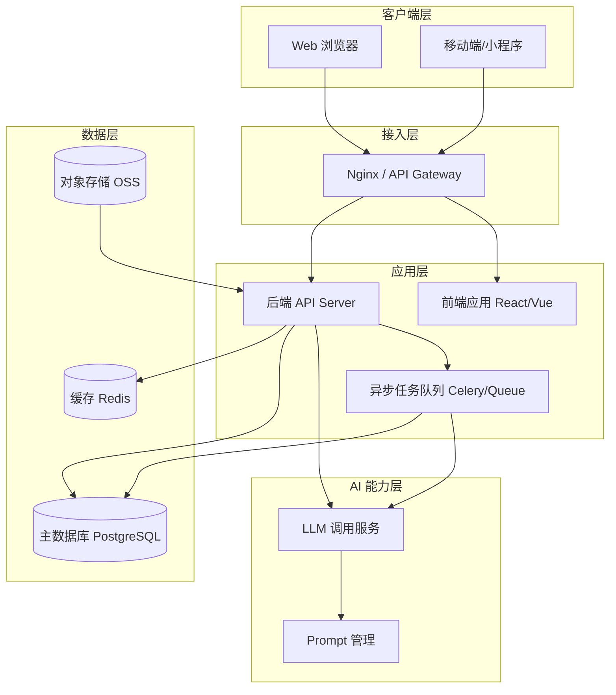
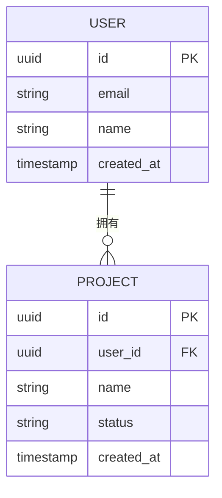
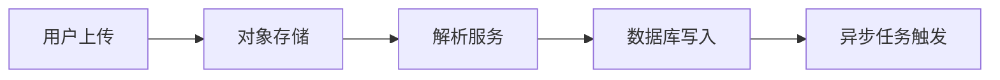
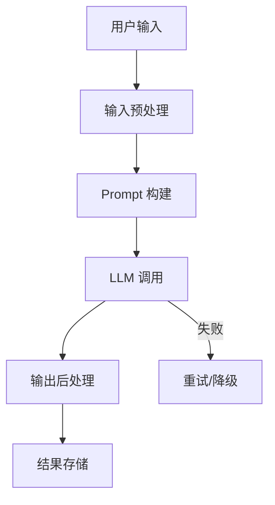
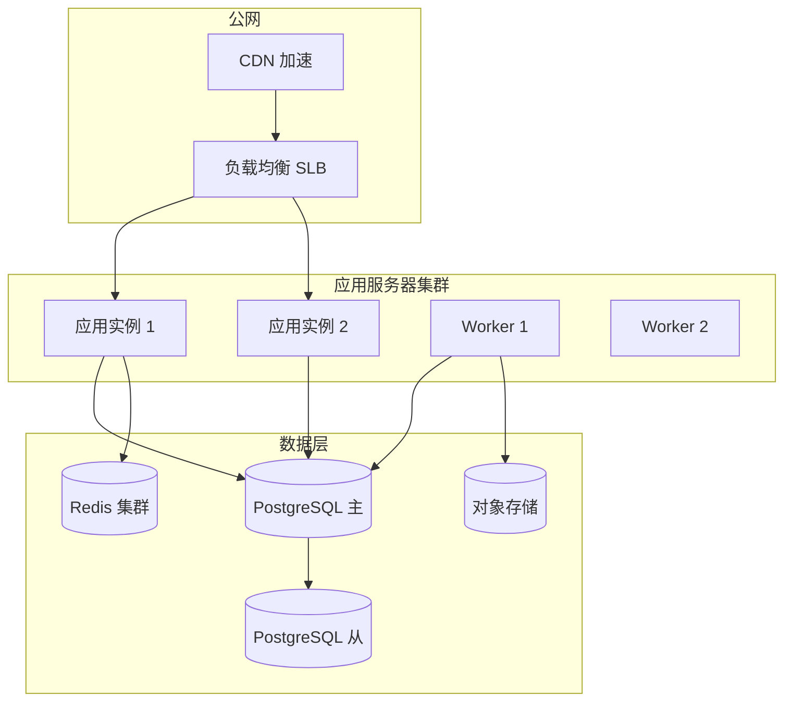
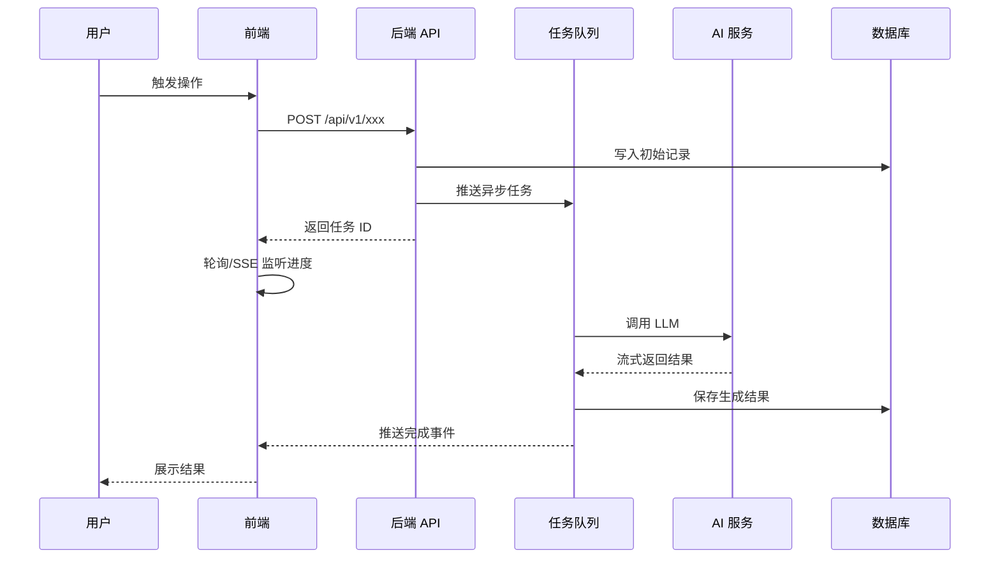

# 架构设计文档撰写

## 描述

本技能指导智能体按统一模板产出架构类 Markdown 文档：在生成前收集必填项（见下文），再落笔总体架构、模块设计、数据与接口、部署与非功能需求等章节；输入可来自需求文档路径、代码库扫描或用户口述归纳。

## 触发条件

当用户提到以下任一情况时使用本技能：
- "帮我写架构文档 / 技术设计文档 / TDD / SAD"
- "整理一份系统设计方案"
- "生成架构设计说明书"
- "画架构图 + 输出文档"
- "我们需要一份架构文档交付给甲方/团队"

---

## 使用前：收集用户输入

**在生成文档之前，必须先向用户收集以下信息。使用 `ask_user` 工具逐步获取。**

### 必填信息（缺少则无法生成）

| 编号 | 信息项 | 说明 | 示例 |
|------|--------|------|------|
| 1 | **项目名称** | 系统/产品的正式名称 | "AI 小说转剧本平台" |
| 2 | **项目背景** | 解决什么问题，服务什么用户 | "帮作者把长篇小说自动拆解为影视剧本" |
| 3 | **核心功能列表** | 本期要实现的主要功能模块（3-10 项） | "上传小说、生成大纲、生成剧本、在线编辑" |
| 4 | **技术栈偏好** | 前端/后端/数据库/AI 框架 | "React + FastAPI + PostgreSQL + OpenAI" |
| 5 | **系统规模预期** | 用户量、并发、数据量的大概量级 | "初期 1000 用户，QPS < 50" |

### 选填信息（有则更精准）

| 编号 | 信息项 | 说明 |
|------|--------|------|
| 6 | **已有需求文档** | PRD、用例文档、用户故事等，可提供文件路径或粘贴内容 |
| 7 | **已有代码库** | 项目目录路径，AI 可扫描分析现有结构 |
| 8 | **非功能性要求** | 性能、安全、可用性、合规等明确要求 |
| 9 | **第三方集成** | 需要对接的外部系统（支付、地图、短信、云存储等） |
| 10 | **团队规模与交付时间** | 影响架构复杂度建议 |
| 11 | **部署环境** | 云厂商偏好（AWS/阿里云/腾讯云）、容器化要求 |
| 12 | **文档受众** | 面向开发团队 / 甲方评审 / 运维团队（影响详细程度和风格） |

### 输入补充说明

如果用户提供了以下任一输入，可跳过部分必填项：
- 提供**需求文档路径** → 自动解析，不需要再问功能列表
- 提供**代码库路径** → 自动分析技术栈，不需要再问技术栈
- 提供**口头描述** → AI 主动归纳并二次确认

---

## 输出格式

输出为 Markdown 格式架构文档，文件名建议：`架构设计文档_v1.0_{项目名}.md`

---

## 架构文档完整模板

```markdown
# {项目名称} — 系统架构设计文档

| 项目 | 内容 |
|------|------|
| 文档版本 | v1.0 |
| 编写日期 | {日期} |
| 作者 | {作者} |
| 审阅人 | {审阅人} |
| 状态 | 草稿 / 评审中 / 已批准 |

## 变更记录

| 版本 | 日期 | 修改人 | 变更内容 |
|------|------|--------|----------|
| v1.0 | {日期} | {作者} | 初稿 |

---

## 一、背景与目标

### 1.1 项目背景

> 简述业务背景：当前痛点是什么，为什么需要构建这个系统。

### 1.2 产品定位

> 一句话说清楚这个系统是什么、为谁服务、解决什么核心问题。

### 1.3 核心目标

- 目标一：...
- 目标二：...
- 目标三：...

### 1.4 本期范围

**本期包含：**
- 功能模块 A
- 功能模块 B

**本期不包含（明确排除）：**
- 功能 X（后续版本实现）
- 功能 Y（第三方系统负责）

### 1.5 假设与约束

| 类型 | 内容 |
|------|------|
| 技术约束 | 必须使用公司现有的 XXX 框架 |
| 资源约束 | 团队 N 人，交付周期 M 周 |
| 外部依赖 | 依赖第三方 API X，受其 SLA 限制 |

---

## 二、总体架构

### 2.1 架构风格

> 说明采用的架构模式及选型理由，例如：
> - 单体架构（适合早期快速迭代）
> - 微服务架构（适合大团队、独立部署）
> - 事件驱动架构（适合异步流水线）
> - Serverless（适合低频突发流量）

**本项目采用：{架构风格}**

选型理由：...

### 2.2 系统总体结构图



### 2.3 技术选型

| 层级 | 技术选型 | 版本 | 选型理由 |
|------|----------|------|----------|
| 前端框架 | React / Vue 3 | - | - |
| 后端框架 | FastAPI / NestJS | - | - |
| 数据库 | PostgreSQL | 15+ | - |
| 缓存 | Redis | 7+ | - |
| 消息队列 | Celery + Redis / RabbitMQ | - | - |
| AI 接入 | OpenAI API / OpenRouter | - | - |
| 对象存储 | 阿里云 OSS / S3 | - | - |
| 容器化 | Docker + Docker Compose | - | - |
| 编排 | Kubernetes（可选） | - | - |

---

## 三、核心模块设计

> 对每个核心模块按以下结构描述：

### 3.1 模块：{模块名称}

**职责：** 该模块负责什么

**输入：** 接受什么数据/事件触发

**输出：** 产出什么数据/调用什么下游

**核心逻辑：**
1. 步骤一
2. 步骤二
3. 步骤三

**接口：**
```
POST /api/v1/{resource}
Request: { ... }
Response: { ... }
```

**依赖：** 依赖哪些其他模块或外部服务

---

## 四、数据架构

### 4.1 核心数据模型（ER 图）



### 4.2 数据库表设计

#### 表：{表名}

| 字段名 | 类型 | 约束 | 说明 |
|--------|------|------|------|
| id | UUID | PK | 主键 |
| created_at | TIMESTAMP | NOT NULL | 创建时间 |
| updated_at | TIMESTAMP | NOT NULL | 更新时间 |

### 4.3 数据流向



### 4.4 数据存储策略

| 数据类型 | 存储位置 | 保留策略 |
|----------|----------|----------|
| 结构化业务数据 | PostgreSQL | 永久保留 |
| 会话缓存 | Redis | TTL 24h |
| 上传文件 | 对象存储 OSS | 永久保留 |
| 日志 | ELK / 云日志服务 | 保留 30 天 |

---

## 五、接口设计规范

### 5.1 统一响应格式

```json
{
  "code": 0,
  "message": "success",
  "data": {},
  "request_id": "uuid"
}
```

### 5.2 错误码规范

| 错误码 | 含义 |
|--------|------|
| 0 | 成功 |
| 400xx | 客户端错误（参数校验、业务规则） |
| 401xx | 认证失败 |
| 403xx | 权限不足 |
| 500xx | 服务端错误 |

### 5.3 核心 API 清单

| 方法 | 路径 | 说明 | 认证 |
|------|------|------|------|
| POST | /api/v1/auth/login | 用户登录 | 否 |
| GET | /api/v1/projects | 项目列表 | 是 |
| POST | /api/v1/projects | 创建项目 | 是 |

### 5.4 实时推送方案

> 如需实时推送（流式生成、进度更新等），说明方案选型：

- **SSE（Server-Sent Events）**：适合服务端单向推流，轻量简单
- **WebSocket**：适合双向实时交互
- **轮询**：兜底方案，兼容性强但低效

**本项目采用：{方案}**

---

## 六、AI 能力架构（如涉及 AI 功能）

### 6.1 AI 流水线设计



### 6.2 Prompt 管理策略

| 场景 | Prompt 类型 | Token 预算 |
|------|------------|------------|
| 场景 A | System + User | ~2000 tokens |
| 场景 B | System + Few-shot | ~4000 tokens |

### 6.3 模型路由与降级

| 优先级 | 模型 | 场景 | 降级策略 |
|--------|------|------|----------|
| 1 | GPT-4o | 核心生成 | 失败切 Claude |
| 2 | Claude 3.5 | 备用 | 失败切 GPT-3.5 |
| 3 | GPT-3.5-turbo | 兜底 | 返回错误 |

### 6.4 流式输出处理

```python
# SSE 流式输出示例
async def stream_response(prompt: str):
    async for chunk in llm_client.stream(prompt):
        yield f"data: {chunk.delta}\n\n"
```

---

## 七、部署架构

### 7.1 环境规划

| 环境 | 用途 | 域名 | 说明 |
|------|------|------|------|
| 开发（dev） | 本地开发联调 | localhost | Docker Compose |
| 测试（test） | QA 测试 | test.example.com | 自动部署 |
| 预发（staging） | 上线前验证 | staging.example.com | 镜像生产 |
| 生产（prod） | 线上服务 | example.com | 高可用部署 |

### 7.2 生产部署拓扑图



### 7.3 Docker Compose 配置（开发环境）

```yaml
version: '3.8'
services:
  api:
    build: ./backend
    ports:
      - "8000:8000"
    environment:
      - DATABASE_URL=postgresql://user:pass@db:5432/appdb
      - REDIS_URL=redis://redis:6379
    depends_on:
      - db
      - redis

  worker:
    build: ./backend
    command: celery -A app.worker worker --loglevel=info
    depends_on:
      - db
      - redis

  frontend:
    build: ./frontend
    ports:
      - "3000:3000"

  db:
    image: postgres:15
    volumes:
      - pgdata:/var/lib/postgresql/data
    environment:
      - POSTGRES_DB=appdb
      - POSTGRES_USER=user
      - POSTGRES_PASSWORD=pass

  redis:
    image: redis:7-alpine

volumes:
  pgdata:
```

---

## 八、非功能性设计

### 8.1 性能指标

| 指标 | 目标值 | 测量方式 |
|------|--------|----------|
| 普通 API 响应时间 | P99 < 500ms | APM 监控 |
| AI 生成首 token 时间 | < 3s | 自定义埋点 |
| 系统吞吐量 | > {N} QPS | 压测验证 |
| 页面首屏加载 | < 2s | Lighthouse |

### 8.2 可用性设计

| 措施 | 说明 |
|------|------|
| 多实例部署 | 应用层 2+ 实例，LB 自动摘除故障节点 |
| 数据库主从 | 主库写，从库读，自动故障切换 |
| 熔断降级 | AI 调用超时或失败时返回友好提示 |
| 健康检查 | 每 30s 检查一次，3 次失败摘除节点 |

**SLA 目标：99.5%（年停机 < 43.8h）**

### 8.3 安全设计

| 维度 | 措施 |
|------|------|
| 认证 | JWT / Session，Token 有效期 24h |
| 授权 | RBAC 权限模型 |
| 传输加密 | 全站 HTTPS，TLS 1.3 |
| 数据加密 | 敏感字段 AES-256 加密存储 |
| 注入防护 | ORM 参数化查询，禁止拼接 SQL |
| 限流 | 按用户/IP 限流，防止滥用 |
| 文件安全 | 上传文件类型白名单，病毒扫描 |

### 8.4 可观测性

| 维度 | 工具 | 说明 |
|------|------|------|
| 日志 | ELK / 云日志 | 结构化日志，统一 request_id |
| 指标监控 | Prometheus + Grafana | CPU、内存、QPS、错误率 |
| 链路追踪 | Jaeger / SkyWalking | 跨服务请求追踪 |
| 告警 | PagerDuty / 钉钉 | 异常自动通知 |

---

## 九、关键流程时序图

### 9.1 {核心流程 A} 时序



---

## 十、风险与应对

| 风险 | 概率 | 影响 | 应对措施 |
|------|------|------|----------|
| LLM API 不稳定 / 超时 | 中 | 高 | 多模型备份，超时熔断，用户友好提示 |
| 数据库单点故障 | 低 | 高 | 主从架构，定期备份，快速切换方案 |
| 高并发下性能下降 | 中 | 中 | 压测提前验证，限流保护，水平扩容 |
| 用户数据泄露 | 低 | 极高 | 最小权限原则，加密存储，定期安全审计 |
| 第三方依赖停服 | 低 | 高 | 关键依赖有备选方案，合同 SLA 保障 |

---

## 十一、附录

### A. 术语表

| 术语 | 说明 |
|------|------|
| LLM | Large Language Model，大语言模型 |
| SSE | Server-Sent Events，服务端推送事件 |
| ORM | Object-Relational Mapping，对象关系映射 |

### B. 参考文档

- 需求文档：{路径或链接}
- API 详细设计：{路径或链接}
- 数据库 Schema：{路径或链接}

### C. 架构决策记录（ADR）

#### ADR-001：{决策标题}

- **状态**：已采纳
- **背景**：为什么需要做这个决策
- **决策**：最终选择了什么
- **理由**：为什么选这个
- **否定方案**：考虑过但未选择的方案及原因
- **后果**：这个决策带来的影响
```

---

## 执行步骤

收到用户请求后，按以下步骤操作：

### Step 1：信息收集

使用 `ask_user` 工具，按"必填 → 选填"顺序收集信息。

**如果用户提供了文档路径：**
```
read_file(path="用户提供的路径")
```

**如果用户提供了代码库路径：**
```
list_directory(path="代码库路径", recursive=true)
# 扫描主要配置文件推断技术栈
```

### Step 2：信息确认

将收集到的信息整理成摘要，用 `ask_user` 二次确认关键假设，避免生成后大量返工。

重点确认：
- 架构风格（单体 vs 微服务）
- AI 功能是否涉及（影响第六章）
- 文档受众（开发团队 vs 甲方评审）
- 文档详细程度（精简版 5 章 vs 完整版 11 章）

### Step 3：生成文档

基于收集的信息，**逐章填充模板**，注意：

- 所有 `{占位符}` 都必须替换为实际内容
- Mermaid 图表根据实际模块关系绘制，不要使用模板示例图
- 技术选型表格必须填入真实选型和理由
- 数据库表结构必须列出实际业务字段

### Step 4：输出与保存

```python
# 写入文件
write_file(
    path="用户指定路径/架构设计文档_v1.0_{项目名}.md",
    content="生成的完整文档内容"
)

# 验证文件
read_file(path="写入路径")
```

### Step 5：验证并汇报

读取文件内容，逐章验证完整性，确认后汇报结果给用户，包括：
- 文件保存路径
- 文档章节概览
- 关键设计决策摘要

---

## 质量检查清单

生成文档后，自检以下项目：

- [ ] 所有 `{占位符}` 已替换为实际内容
- [ ] Mermaid 图表语法正确可渲染
- [ ] 技术选型有明确理由，不是泛泛而谈
- [ ] 数据库表有实际业务字段，不只是 id + timestamp
- [ ] API 清单与模块设计一致
- [ ] 非功能性指标有具体数值，不是"高性能"、"高可用"等空话
- [ ] 风险与应对措施具体可操作
- [ ] 文档受众匹配（技术深度、术语使用）

---

## 输出示例（节选）

> 参考《AI 小说转剧本平台架构设计文档》，该文档基于本技能生成，涵盖：
> - AI 四阶段流水线（大纲 → 事件卡 → 剧本 → 改写）
> - SSE 流式推送设计
> - 版本不可变策略
> - 多模型路由与降级
> - 完整的 PostgreSQL 数据模型

---

*Skill 版本：1.1.0 | `SKILL.md` 含 YAML frontmatter（`name` / `description`），兼容 Cursor Agent Skills 目录结构*
