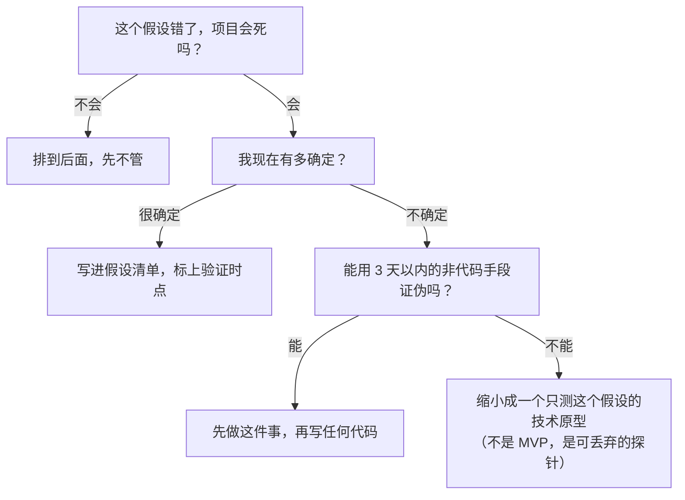

# MVP 范围裁剪

## 这个技能解决什么

**核心原则：MVP 不是功能的子集，而是「能产出证据的最小东西」。决定先做什么的不是实现难度，而是——哪个假设错了会直接让项目死掉。**

两个最常见的死法：

1. **把验证排在开发之后。** 典型症状：计划里写「第 1–12 周开发，第 13–24 周验证」。这时候验证已经不是验证，是事后确认。
2. **按实现难度排序。** 先搭框架、先做用户系统、先做漂亮 UI —— 这些都不是风险点，做完了你依然不知道有没有人要。

## 触发条件

- 拿到的需求里列了 6 个以上功能，且都说「必须」
- 有人在排期里把「上线后看数据」放在很后面
- 需要向别人解释「为什么先不做 XX」
- 已经写了不少代码，但说不清怎么算成功

## 不适用

- 需求已经被付费客户锁定（合同写了交付范围）—— 那是项目管理，不是 MVP 裁剪
- 纯技术重构 —— 没有「验证假设」这一层

## 核心流程

### 第一步：先列出假设，不是列出功能

功能列表回答不了「先做什么」。先把它翻译成假设清单：

| 类型 | 例子 | 错了会怎样 |
| --- | --- | --- |
| 价值假设 | 用户确实为「忘记记账」这件事烦恼 | 全盘皆输 |
| 行为假设 | 用户愿意手动记每一笔账 | 全盘皆输 |
| 付费假设 | 用户愿意为此每月付 20 元 | 赚不到钱 |
| 渠道假设 | 我能在一个渠道里持续拿到用户 | 长不大 |
| 技术假设 | 银行流水可以合法且稳定地拿到 | 功能做不出来 |
| 实现假设 | 一个人 10 周能做出可用版本 | 延期 |

### 第二步：按「错了会死吗」排序，不按实现难度排序

给每个假设打分：**致命度**（错了项目是否直接死）× **不确定度**（你现在有多没底）。

**先打掉「致命且高不确定」的那些 —— 而且要用最便宜的方式打掉，不是写代码。**



**最强的一条纪律：在写第一行业务代码之前，至少用非代码手段证伪过一个致命假设。**

非代码手段排在最前面，因为它们便宜 100 倍：礼宾测试（手动提供服务）、假门测试（做个落地页看有没有人留资）、预售（直接开卖）、访谈（参考 `01-discover/pain-point-discovery`）。

### 第三步：砍到一个闭环

MVP 只允许有**一个**核心闭环：**用户完成一次核心任务的全过程**。

判断标准：如果某个功能删掉之后，用户还能走完「打开 → 完成核心任务 → 得到结果」，那它就不该在第一版里。

**砍功能四问**（任何功能过不了就砍）：

1. 删掉它，核心闭环还成立吗？（成立 → 砍）
2. 用户会不会因为缺它而不用产品？（不致命 → 砍）
3. 有没有人工替代方案？（有 → 用人工，先不做）
4. 它验证的是哪个假设？（答不上来 → 砍）

**四类必砍项**：

| 类型 | 例子 | 为什么砍 |
| --- | --- | --- |
| 依赖外部资质/合作 | 银行直连、支付牌照、平台授权 | 周期不可控，且失败概率高 |
| 复杂度乘数 | 多人协作、权限体系、实时同步、多端一致 | 一个功能让其余所有功能的复杂度翻倍 |
| 冷启动无数据的功能 | 自训推荐模型、智能分类 | 没有数据时不如规则 |
| 把一次性变常态 | 全票种识别、全行业模板 | 长尾覆盖率极低，维护成本极高 |

**必须留的**：数据模型里为未来功能预留的字段。预留成本接近零，事后迁移代价极高 —— 但**只预留字段，不实现逻辑**。

### 第四步：写下成功的阈值和反向信号

在开发**之前**写。开发完再写，你只会写出自己能达成的标准。

```markdown
## MVP 验收标准        日期：____

北极星指标：____（必须是可行动的业务指标，不是注册量）
定义口径：____（分子/分母/时间窗，写清楚到别人能复现）

| 维度 | 指标 | 及格线 |
|---|---|---|
| 核心体验 | 完成一次核心任务耗时 / 点击数 | ≤ __ |
| 激活 | 首周完成 ≥ N 次核心动作的用户占比 | ≥ __% |
| 留存 | D7 / D30 | ≥ __% / ≥ __% |
| 价值 | 完成核心任务后主动查看结果的比例 | ≥ __% |
| 商业 | 免费 → 付费转化 | ≥ __% |

反向信号（出现即说明做错了，回炉而不是加功能）：
1. 用户集中在注册当天使用，之后不再打开 → 核心体验摩擦太大
2. 大量用户走到某一步就流失 → 埋点定位，改流程而不是加功能
3. 反馈集中在「能不能加 XX」而非「核心任务不好用」→ 你在解决错的问题
4. 付费转化低于 __% → 付费墙位置或免费版边界错了
```

### 第五步：只排「能验证」的期，不排「做功能」的期

排期的最小单位不是天，是**里程碑**，每个里程碑必须以一个可观测的信号结束：

```
M1  核心闭环能跑通（自己连续用 7 天不碰其他工具）
M2  10 个非熟人真实用户跑通闭环
M3  达到激活线，开始测留存
M4  留存达标，开始测付费
```

**M2 之前不许加任何新功能。** 一个不会用的东西，加功能只会让它更不会用。

## Red Flags — 出现这些想法就停下

- 「先把功能都做完再上线验证」→ 验证已经变成事后确认，你只是不想面对
- 「这个功能很简单，顺手就做了」→ 每个「顺手」都在推迟你获得信息的时间
- 「MVP 就是功能的子集，先做 60% 的功能」→ MVP 是证据的最小单元，不是功能的缩小版
- 「用户没提，但我们得先准备好」→ 你在为想象中的用户写代码
- 「测试/埋点等有用户了再补」→ 没有埋点，你就永远不知道自己错在哪
- 「架构要先支撑百万用户」→ 第一版的目标是 10 个真实用户，不是百万
- 「技术债以后再还」→ 记下来可以，但不要用这句话为「明知会返工的方案」开脱

**出现任一条：回到第一步，重排假设。**

## 常见错误

| 错误 | 修正 |
| --- | --- |
| 用功能列表代替假设清单 | 每个功能必须对应一个它能验证的假设 |
| 按实现难度排优先级 | 按「错了会不会死」× 不确定度排 |
| 把验证放到开发后 | 至少一个致命假设必须在写代码前用非代码手段证伪 |
| 阈值凭感觉定 | 查行业基准，或用自己的历史数据校准，并写下口径 |
| 把技术原型当 MVP | 技术原型是可丢弃的探针，MVP 是能交付给真实用户的东西 |
| 一次砍到只剩登录页 | 砍的是功能，不是闭环。闭环不完整就不算 MVP |

## 相关工作

- 假设还没验证过 → 先做 `01-discover/pain-point-discovery`
- 方案还没定 → `02-design/writing-plans`
- 上线后有数据了 → `04-verify/value-validation`
- 要算这个 MVP 的商业可行性 → `05-business/business-model-fluency`
